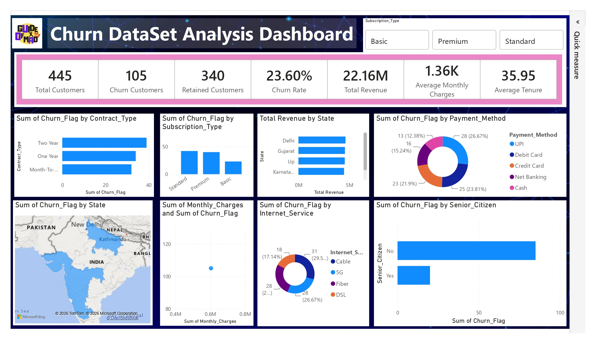

# Customer Churn Analysis — End-to-End Data Analytics Project

> An end-to-end analytics case study on Indian telecom customer churn — from dirty Excel data to a Power BI executive dashboard.
> **Headline finding: 23.60% churn (105 of 445 customers). Long-term and premium customers churn the most — a retention risk worth \~₹5.2M of the ₹22.16M revenue base.**

## 📊 Dashboard Preview



*Power BI dashboard: 7 KPI cards + 8 visuals with Subscription Type slicer (Basic / Premium / Standard)*

## 📌 Overview

Customer churn is the silent revenue killer for subscription businesses. This project answers one business question:

**Who is churning, why, and where should retention focus?**

Using a 542-row raw telecom dataset, this project demonstrates a complete analytics workflow:

1. **Clean** messy Excel data with Python (pandas)
2. **Store &amp; analyze** clean data in MySQL with 15 business SQL queries
3. **Visualize** KPIs and churn drivers in an interactive Power BI dashboard

**Final dataset:** 445 customers in dashboard view (492 rows after cleaning, 445 after BI-level filtering) | **Churn rate:** 23.60% | **Total revenue:** 22.16M

## 🧩 Business Problem

- Acquiring a new customer costs 5–7x more than retaining one.
- The business was losing nearly **1 in 4 customers** without knowing which segment, contract, payment mode, or service was driving it.
- Raw data was unusable: duplicates, missing values, inconsistent casing, invalid ages, negative charges, and non-standard dates.

**Goal:** Build a trusted, analysis-ready dataset and a single dashboard that lets stakeholders slice churn by contract, subscription, state, payment method, internet service, tenure, and senior-citizen status.

## 🏗️ Project Workflow

```text
Excel (Dirty Data)
   ↓
Python (pandas) → Data Cleaning + Feature Engineering → Clean Excel
   ↓
MySQL Database (customer_churn table)
   ↓
SQL Analysis (15 business queries)
   ↓
Power BI Dashboard (KPIs + 8 visuals + slicers)
```

## 🛠️ Tech Stack

| Layer                | Tool                                           |
| -------------------- | ---------------------------------------------- |
| Raw &amp; Clean Data | Microsoft Excel (`.xlsx`)                      |
| Data Cleaning        | Python 3.12, pandas, NumPy, Jupyter Notebook   |
| Database             | MySQL (`customer_churn` table)                 |
| Analysis             | SQL (aggregations, `GROUP BY`, `CASE WHEN`)    |
| Visualization        | Power BI (DAX measures, bar/donut/map/scatter) |
| Documentation        | Markdown                                       |

## 📁 Repository Structure

```text
Customer Churn/
├── dataset/
│   ├── Churn_Unclean_Project.xlsx   # Raw input — 542 rows × 18 cols
│   └── Clean_Churn_Data.xlsx        # Clean output — 492 rows × 23 cols
├── scripts/
│   ├── DataAnalysis.ipynb           # Full cleaning + feature engineering
│   └── DataAnalysis.sql             # 15 business analysis queries
├── Dashboard_view.jpg               # Power BI dashboard snapshot
└── Readme.md
```

## 📦 Dataset Description

**Grain:** one row per customer.

**Raw columns (18):** `Customer_ID, Customer_Name, Gender, Age, State, City, Tenure_Months, Subscription_Type, Monthly_Charges, Total_Charges, Contract_Type, Payment_Method, Internet_Service, Tech_Support, Senior_Citizen, Dependents, Churn, Last_Interaction_Date`

**Coverage:** States — Maharashtra, Delhi, UP, Gujarat, Karnataka. Payment modes — UPI, Debit Card, Credit Card, Net Banking, Cash. Internet — Fiber, DSL, Cable, 5G. Contracts — Month-to-Month, One Year, Two Year. Subscriptions — Basic, Standard, Premium.

### Data Quality Issues Found

- 7 exact duplicate rows
- Missing values in 17 of 18 columns (notably `Payment_Method: 16, Monthly_Charges: 13, State: 11`)
- Placeholder dirties: `N/A, NULL, "", " "`
- Leading/trailing spaces + inconsistent casing: `basic / Basic / BASIC, male / Male, UP / Up, YES / Yes / yes`
- Invalid numerics: `Age 3–165, Monthly_Charges -2454.77, Total_Charges -99781.82`
- Unparsed dates in `Last_Interaction_Date` (`DD-MM-YYYY` mixed formats)

## 🧹 Data Cleaning (Python — `scripts/DataAnalysis.ipynb`)

| Step                      | Action                                                                                              |
| ------------------------- | --------------------------------------------------------------------------------------------------- |
| 1. Audit                  | `head(), info(), describe(), shape, isnull().sum(), duplicated().sum()`                             |
| 2. Deduplicate            | `drop_duplicates()` — 542 → 535 rows                                                                |
| 3. Normalize placeholders | `replace(["N/A","NULL",""," "], np.nan)`                                                            |
| 4. Trim whitespace        | `df.apply(lambda x: x.str.strip())` on object columns                                               |
| 5. Standardize casing     | `str.title()` on `Customer_Name, State, City, Subscription_Type, Contract_Type`                     |
| 6. Standardize Churn      | `str.strip().str.upper()` then map `YES → Yes, NO → No`                                             |
| 7. Coerce numerics        | `pd.to_numeric(errors="coerce")` for `Age, Tenure_Months, Monthly_Charges, Total_Charges`           |
| 8. Remove invalid rows    | Keep `Age 18–100`, `Monthly_Charges >= 0`, `Total_Charges >= 0` — 535 → 492 rows                    |
| 9. Parse dates            | `pd.to_datetime(Last_Interaction_Date, errors="coerce")`                                            |
| 10. Impute                | `Tech_Support → "No"`, `Payment_Method → "Unknown"`, `Age / Tenure_Months / Monthly_Charges → mean` |
| 11. Export                | `to_excel("dataset/Clean_Churn_Data.xlsx", index=False)`                                            |

> **Note on paths:** the notebook resolves the project root with `pathlib` so it runs whether launched from the project root or from `scripts/`. If you open the notebook from `scripts/`, `dataset/` is auto-resolved to `../dataset/`.

## ✨ Feature Engineering

| Feature           | Formula                                                  | Why it matters                                                          |
| ----------------- | -------------------------------------------------------- | ----------------------------------------------------------------------- |
| `Customer_Value`  | `Monthly_Charges × Tenure_Months`                        | Proxy for Customer Lifetime Value (CLV); powers Top-10 high-value query |
| `Monthly_Revenue` | `= Monthly_Charges`                                      | ARPU building block; Total Monthly Revenue = 668,737.24                 |
| `Tenure_Group`    | `pd.cut([0,12,24,48,72] → 0-12 / 13-24 / 25-48 / 49-72)` | Cohort analysis: 25-48 mo is largest (183)                              |
| `Senior_Flag`     | `Age >= 60 → Senior else Adult`                          | Adult 399 vs Senior 93                                                  |
| `Churn_Flag`      | `Yes → 1, No → 0`                                        | Numeric churn for DAX: 116 churned (23.67% in Python output)            |

Final clean shape: **492 rows × 23 columns** (18 original + 5 engineered).

## 🗄️ SQL Analysis (MySQL — `scripts/DataAnalysis.sql`)

Table: `customer_churn` (loaded from `Clean_Churn_Data.xlsx`).

| #   | Analysis                       | Question answered                                                          |
| --- | ------------------------------ | -------------------------------------------------------------------------- |
| 1   | Total Customers                | What is the customer base size?                                            |
| 2   | Total Churn Customers          | How many churned (`Churn='Yes'`)?                                          |
| 3   | Churn Rate                     | `SUM(CASE WHEN Churn='Yes')×100/COUNT(*)` — headline KPI                   |
| 4   | Average Monthly Charges        | What is ARPU?                                                              |
| 5   | Average Tenure                 | What is average loyalty (months)?                                          |
| 6   | Customers by Contract Type     | How is base split across Month-to-Month / One Year / Two Year?             |
| 7   | Customers by Internet Service  | Fiber vs DSL vs Cable vs 5G mix?                                           |
| 8   | Churn by State                 | Which states lose the most customers?                                      |
| 9   | Customers by Payment Method    | UPI vs cards vs cash vs net-banking?                                       |
| 10  | Customers by Subscription Type | Basic vs Standard vs Premium?                                              |
| 11  | Revenue by State               | Which states drive the most `SUM(Total_Charges)`?                          |
| 12  | Avg Charges by Contract        | Do short contracts pay more per month?                                     |
| 13  | Senior Citizen Churn           | Do seniors churn disproportionately?                                       |
| 14  | Top 10 High-Value Customers    | Who to prioritize for retention (`ORDER BY Customer_Value DESC LIMIT 10`)? |
| 15  | Customers Without Tech Support | At-risk cohort (`Tech_Support='No'`) for proactive outreach                |

## 📈 Power BI Dashboard

### KPI Cards

| KPI                     | Value      | Definition (DAX logic)                        |
| ----------------------- | ---------- | --------------------------------------------- |
| Total Customers         | **445**    | `COUNT(Customer_ID)`                          |
| Churn Customers         | **105**    | `CALCULATE(COUNT, Churn="Yes")`               |
| Retained Customers      | **340**    | `CALCULATE(COUNT, Churn="No")`                |
| Churn Rate              | **23.60%** | `DIVIDE([Churn Customers],[Total Customers])` |
| Total Revenue           | **22.16M** | `SUM(Total_Charges)`                          |
| Average Monthly Charges | **1.36K**  | `AVERAGE(Monthly_Charges)`                    |
| Average Tenure          | **35.95**  | `AVERAGE(Tenure_Months)`                      |

### Visuals

| Visual                     | Type               | Insight                                                                                           |
| -------------------------- | ------------------ | ------------------------------------------------------------------------------------------------- |
| Churn by Contract Type     | Horizontal bar     | Two Year (\~40) &gt; One Year (\~34) &gt; Month-to-Month (\~32)                                   |
| Churn by Subscription Type | Column             | Standard (\~40) &gt; Premium (\~38) &gt; Basic (\~22)                                             |
| Total Revenue by State     | Bar                | Delhi / Gujarat / UP / Karnataka each \~4–5M — evenly spread                                      |
| Churn by Payment Method    | Donut              | UPI 26.67% (28), Debit 23.81% (25), Credit 21.90% (23), Net Banking 15.24% (16), Cash 12.38% (13) |
| Churn by State             | Filled map (India) | Geographic spread — not a single-state problem                                                    |
| Monthly Charges vs Churn   | Scatter            | Aggregate concentration at \~0.6M charges / 105 churn                                             |
| Churn by Internet Service  | Donut              | Cable 29.5% (31), 5G 26.67% (28), Fiber \~26.7% (28), DSL 17.14% (18)                             |
| Churn by Senior Citizen    | Bar                | Non-senior \~84 vs Senior \~21 — churn is concentrated in non-seniors                             |

**Slicers:** `Subscription_Type` (Basic / Premium / Standard) + Quick Measure pane for ad-hoc DAX.

## 💡 Key Insights &amp; Recommendations

1. **Churn at 23.6% is the #1 risk.** 105 lost customers on a 22.16M base puts roughly one-quarter of revenue at risk. Retention, not acquisition, should be the quarterly OKR.
2. **Long contracts churn MORE — investigate value delivery.** Two-Year churn exceeds Month-to-Month, the opposite of the industry norm. Audit onboarding, renewal experience, and whether 2-year promises (speed, support) are met.
3. **Premium/Standard drive \~78% of churn; Basic is sticky.** Upsell without experience improvement increases churn risk. Gate upgrades behind health checks (support tickets, usage).
4. **UPI + Debit Card = 50%+ of churn.** Review auto-pay failures, UPI mandate drop-offs, and retry logic. Cash has the lowest churn (12.38%).
5. **Non-seniors are \~80% of churn.** Focus win-back and engagement campaigns on the adult segment; seniors are relatively loyal.
6. **Cable is the weakest service (29.5% of churn); DSL is strongest (17.1%).** Correlate with network quality tickets and prioritize Cable fixes. Revenue is evenly spread across states — this is a product/experience issue, not a regional one.

**Recommended next actions:** proactive outreach to the `Tech_Support='No'` cohort, save offers for Top-10 `Customer_Value` accounts, payment-retry automation for UPI/Debit, and Cable quality sprints.


